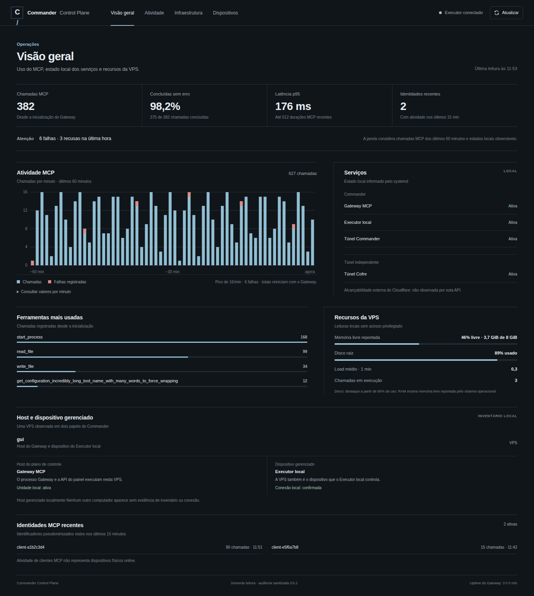
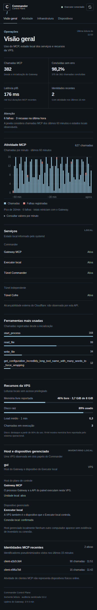

# PR #14 — Evidência visual independente (Chromium + Playwright)

**Escopo:** verificação do frontend na branch do PR 1bbcd3c7896f2a82a782756ca967eb9bb5591686 em ambiente isolado na VPS gui, com **dados sintéticos**, sem usar Cloudflare Access e sem alterar produção. Baseline: main anterior ao PR.

## Antes / depois

| Vista | Antes (main) | Depois (PR #14) |
|---|---|---|
| Notebook (1366 × 768) | [Ver imagem](before-1366x768-normal.png) | [Ver imagem](1366x768-normal.png) |
| Mobile (390 × 844) | [Ver imagem](before-390x844-normal.png) | [Ver imagem](390x844-normal.png) |

Outras capturas: [tablet 768 × 1024](768x1024-normal.png), [mobile 375 × 812](375x812-normal.png) e [erro HTTP 503 controlado no mobile](390x844-error.png).

## Matriz de execução

- Chromium headless + Playwright em diretório isolado e não privilegiado, sem reiniciar gateway, executor ou túneis.
- **15 cenários de navegador:** normal em 1600×900, 1366×768, 1024×768, 768×1024, 390×844, 375×812 e 320×740; adicionalmente em 1366 e 390: **sem chamadas**, **25 mil chamadas**, **serviço parcial** e **HTTP 503**.
- **Zero overflow horizontal** nas 15 renderizações. Sem exceções JavaScript nas telas normais, sem chamadas, alto volume e serviço parcial. Para HTTP 503, o navegador registra apenas o erro de rede esperado; a UI avisa e não inventa números.
- Tabela de valores por minuto: abertura e **60 linhas** nos sete tamanhos normais.
- **axe-core: zero violações WCAG 2 A/AA e 2.1 A/AA** nas larguras 1366, 390 e 375 px. Auditoria automatizada não substitui inspeção humana.
- Via teclado: foco visível no skip link, marca, navegação, botão de atualização; Enter abre a tabela de detalhes.
- Paleta principal: contraste aproximadamente **4,54:1** para a combinação secundária quiet no surface, acima da referência normal WCAG AA.
- Direção visual: sem hero dominante, sidebar fixa, cartões decorativos e excesso de badges; estados locais e externos separados, host e dispositivo gerenciado distinguidos.

## Limitações

O teste foi realizado com **fixtures**, não com sessão autenticada de produção. Não houve deployment. Os textos secundários de 10px merecem **revisão subjetiva de legibilidade no celular**, apesar de axe-core não reportar violações.

**Validação técnica visual e de acessibilidade automatizada: concluída.** Aceite subjetivo pelo proprietário: **pendente**. Não dar merge ou fazer deploy até o proprietário aprovar as capturas.

## Refinamento mobile de legibilidade — 11/10/2026

Somente CSS responsivo da mesma branch: textos operacionais secundários e rótulos pequenos passaram a 11 px ou mais no celular, mantendo hierarquia e densidade editorial. Navegação, marca, botão de atualização e controle de expansão da tabela receberam altura mínima de 44 px. Sem alteração de JavaScript, backend, autenticação, API ou serviços.

- [Mobile refinado 390 × 844](mobile-refined-390x844-normal.png) e [mobile refinado 320 × 740](mobile-refined-320x740-normal.png) — capturas Chromium com fixtures locais, não produção.
- Revalidação no ambiente isolado: 54/54 testes Node PASS; 15 cenários Playwright sem overflow horizontal; tabela de 60 linhas nos sete cenários normais; nos viewports móveis testados, nenhum texto-alvo abaixo de 11 px nem controle-alvo abaixo de 44 px.
- axe-core: zero violações detectadas nas regras WCAG 2 A/AA e 2.1 A/AA em 1366, 390 e 375 px; foco e expansão por Enter preservados.
- A aceitação visual subjetiva pelo proprietário permanece **pendente**. Nada foi mergeado ou implantado.
